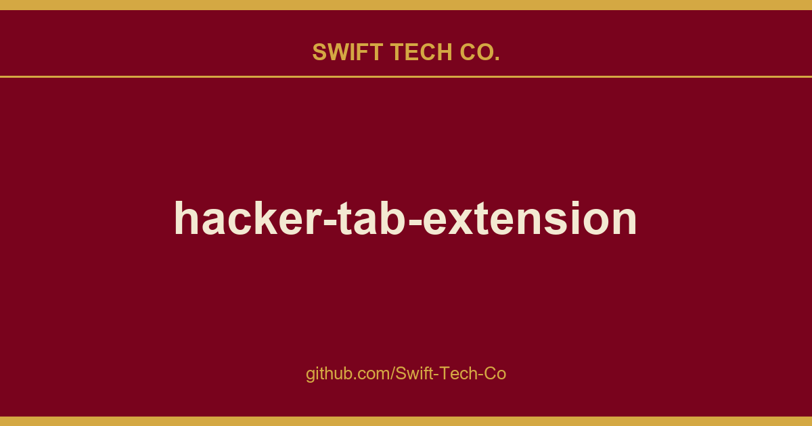
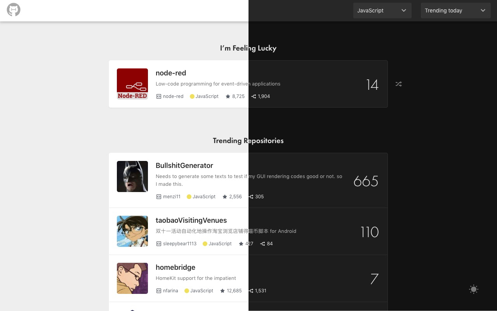

# hacker-tab-extension

## What This Is

Every project needs a shelf of ready answers. product and engineering is one of those shelves, and hacker-tab-extension is the entry on it - the notes, patterns and fixes we reuse when this kind of work comes up.

## Images

## What is Hacker Tab Extension

Hacker Tab replace browser new tab screen with GitHub trending projects, so that developer get to know trending repositories everyday. It loads trending project periodically in background so you do not need to wait for loading every time you open a new tab.

## Install

Trusted by developers! Install Hacker Tab from Chrome Web Store.

## View Online

View Online version of extension.

## Backers

Thank you to all our backers! 🙏

## Feedback

## Give us a rating

## Related

- github-trending-api: The missing APIs for GitHub trending projects and developers.
- How to use React.js to create a cross-browser extension in 5 minutes.
- Hacker Tab on Product Hunt.
- Internal Components

## Disclaimer

---

## Swift Tech Co.

Built and maintained by Swift Tech Co.

AI Automation | FinTech Platforms | Custom Software and Mobile Apps | SaaS Platforms | Cloud Infrastructure | Cybersecurity | SEO and Marketing | API Integration

**Join our community on Telegram:** [t.me/+Qt_eFvkb2rliMzNh](https://t.me/+Qt_eFvkb2rliMzNh)

Home | Services | Careers | Referral Program | Influencers | About | Contact

**Connect**

- Website: https://github.com/Swift-Tech-Co/hacker-tab-extension
- LinkedIn: [linkedin.com/in/stephenoladoke](https://www.linkedin.com/in/stephenoladoke/)
- LinkedIn (Company): [linkedin.com/company/swift-tech-co](https://www.linkedin.com/company/swift-tech-co)
- X: [@MrOladoke](https://x.com/MrOladoke)
- Instagram: [@mr.oladoke](https://www.instagram.com/mr.oladoke/)
- Instagram (Company): [@swifttechco](https://www.instagram.com/swifttechco/)
- Organization: [github.com/Swift-Tech-Co](https://github.com/Swift-Tech-Co)

## Sources

Compiled and maintained from upstream [huchenme/hacker-tab-extension](https://github.com/huchenme/hacker-tab-extension) under permissive open-source license.

---

Maintained by [Swift Tech Co.](https://github.com/Swift-Tech-Co) - [Telegram](https://t.me/+Qt_eFvkb2rliMzNh)

## Sources

Compiled and maintained from upstream [huchenme/hacker-tab-extension](https://github.com/huchenme/hacker-tab-extension) under permissive open-source license.

---

Maintained by [Swift Tech Co.](https://github.com/Swift-Tech-Co) - [Telegram](https://t.me/+Qt_eFvkb2rliMzNh)